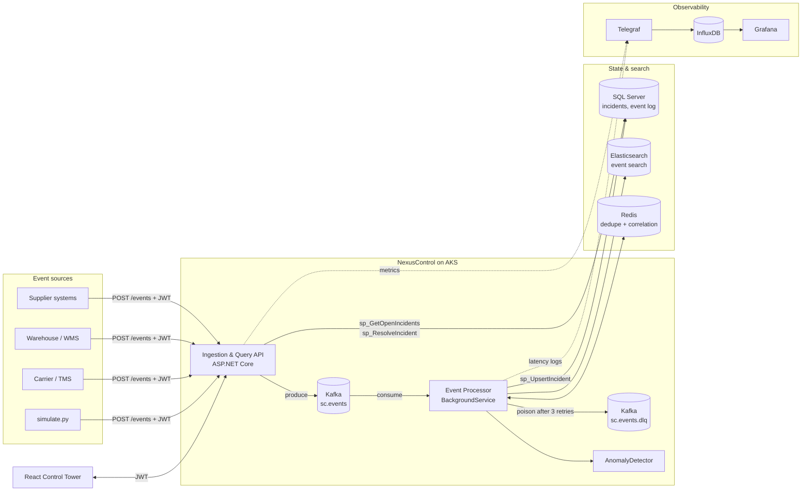
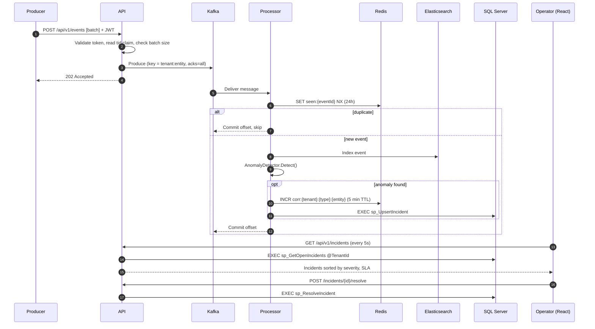
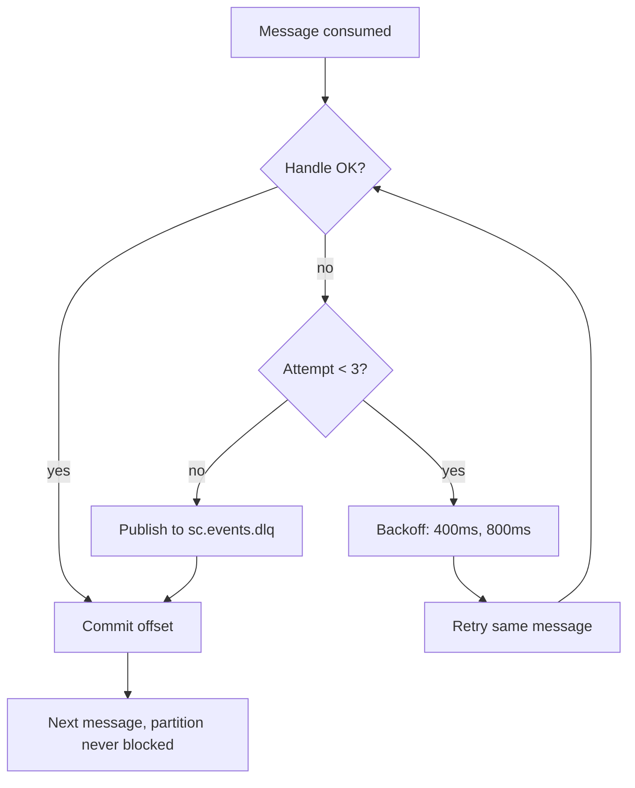

<div align="center">

# NexusControl

### Real-Time Supply Chain Control Tower & Disruption Response Platform

*Detect disruptions in seconds, correlate noisy alerts into actionable incidents, and track every one against its SLA.*


[Overview](#-overview) · [Architecture](#-architecture) · [Features](#-features) · [Quick start](#-quick-start) · [API](#-api-reference) · [Operations](#-observability--operations) · [Roadmap](#-roadmap)

</div>

---

## Table of contents

- [NexusControl](#nexuscontrol)
    - [Real-Time Supply Chain Control Tower \& Disruption Response Platform](#real-time-supply-chain-control-tower--disruption-response-platform)
  - [Table of contents](#table-of-contents)
  - [🧭 Overview](#-overview)
    - [What an operator experiences](#what-an-operator-experiences)
  - [🎯 Why this exists](#-why-this-exists)
  - [✨ Features](#-features)
  - [🏗 Architecture](#-architecture)
    - [System context](#system-context)
    - [Event lifecycle](#event-lifecycle)
    - [Failure handling](#failure-handling)
  - [🧰 Tech stack](#-tech-stack)
  - [📁 Repository layout](#-repository-layout)
  - [📦 Domain model \& event types](#-domain-model--event-types)
    - [Event contract](#event-contract)
    - [Supported event kinds](#supported-event-kinds)
    - [Incident](#incident)
  - [🧠 Detection engine](#-detection-engine)
  - [🛡 Reliability design](#-reliability-design)
  - [🔐 Security \& multi-tenancy](#-security--multi-tenancy)
  - [🗄 Data layer](#-data-layer)
  - [🚀 Quick start](#-quick-start)
    - [Prerequisites](#prerequisites)
    - [1. Start dependencies](#1-start-dependencies)
    - [2. Create the database](#2-create-the-database)
    - [3. Run the services](#3-run-the-services)
    - [4. Create a development token](#4-create-a-development-token)
    - [5. Generate traffic](#5-generate-traffic)
    - [6. Open Grafana](#6-open-grafana)
  - [📡 API reference](#-api-reference)
    - [`POST /events` (role: `producer`)](#post-events-role-producer)
    - [`GET /incidents` (role: `operator`)](#get-incidents-role-operator)
    - [`POST /incidents/{id}/resolve` (role: `operator`)](#post-incidentsidresolve-role-operator)
    - [Health](#health)
  - [📊 Observability \& operations](#-observability--operations)
    - [Signals](#signals)
    - [Suggested Grafana panels](#suggested-grafana-panels)
    - [Runbook highlights](#runbook-highlights)
  - [☸ Kubernetes deployment](#-kubernetes-deployment)
  - [🧪 Testing](#-testing)
  - [📏 Measuring performance](#-measuring-performance)
  - [🧩 Design decisions](#-design-decisions)
  - [⚠️ Known limitations](#️-known-limitations)
  - [🗺 Roadmap](#-roadmap)
  - [🤝 Contributing](#-contributing)
  - [📄 License](#-license)

---

## 🧭 Overview

**NexusControl** is an event-driven, multi-tenant microservices platform that acts as a **control tower** for a supply chain. It ingests a continuous stream of events (shipments, inventory levels, supplier scores, order metrics), detects disruptions such as delays, stockouts, supplier risk and fulfillment exceptions, groups related alerts into a single **incident**, and gives operators a live view with SLA tracking and a way to record remediation.

It is built on the stack typical of modern enterprise supply-chain platforms: **C# / ASP.NET Core, Kafka, SQL Server, Redis, Elasticsearch, React, Kubernetes on Azure**, with production observability via **Telegraf, InfluxDB and Grafana**.

> **Scope note:** NexusControl focuses on *monitoring, detection, incident response and observability*. It intentionally does not model transactional execution (procurement, catalog, order management). It is the real-time layer that sits on top of those systems.

### What an operator experiences

```
 Supplier score drops to 41         Shipment delayed 80h            Stock hits 0
          │                                  │                           │
          ▼                                  ▼                           ▼
   SupplierRisk  (S3)                 ShipmentDelay (S4)           Stockout (S4)
          │                                  │                           │
          └────── repeated alerts on the same entity collapse into ONE incident ──────┘
                                             │
                                  Dashboard: sorted by severity, then SLA due time
                                             │
                          Operator resolves with a remediation note → audit trail in SQL
```

---

## 🎯 Why this exists

Transactional systems tell you *what happened*. A control tower tells you *what is going wrong right now* and *who needs to act on it*. The engineering problems in that space are different from CRUD:

| Problem | How NexusControl approaches it |
|---|---|
| Events arrive in bursts, out of order, and sometimes twice | Keyed Kafka partitions, idempotent producer, Redis de-duplication |
| One root cause produces dozens of alerts | Alert correlation into a single escalating incident |
| A bad message must not stall the pipeline | Bounded retries with backoff, then a dead-letter topic |
| Many customers share one platform | Tenant identity from the token, enforced in every SQL path |
| "Is it healthy?" needs evidence | Health probes, structured latency logs, Telegraf → InfluxDB → Grafana |
| Production issues need fast diagnosis | A runbook covering consumer lag, SQL plans, network traces and PerfMon |

---

## ✨ Features

**Ingestion & streaming**
- REST ingestion endpoint accepting batches of up to 1,000 events
- Kafka producer with `acks=all` and idempotence enabled
- Per-entity message keys (`{tenant}:{entity}`) to preserve ordering for a given SKU, shipment or supplier

**Detection & incident management**
- Rule-based detection: shipment delay, stockout, low stock, supplier risk
- Statistical fallback: z-score outlier detection on any metric
- Alert correlation: repeated alerts on the same entity within a window become one incident with a rising alert count and escalating severity
- SLA deadline per incident type, with breach flag computed in SQL
- Operator remediation notes stored with the resolution

**Reliability**
- Manual offset commits (commit only after the work is done)
- Exponential-backoff retries, then dead-letter topic `sc.events.dlq`
- 24-hour idempotency keys in Redis so replays do not create duplicate incidents
- Transactional, lock-protected upsert in SQL to stay correct under concurrent consumers

**Security**
- OAuth2 / OIDC JWT bearer authentication (Azure AD / Entra ID in cloud, symmetric dev key locally)
- Role-based policies: `producer`, `operator`, `admin`
- Tenant isolation derived from a token claim, never from request payloads

**Observability**
- Liveness and readiness endpoints
- Per-event processing latency logged in a scrapeable format
- Telegraf host metrics (including Windows PerfMon counters) into InfluxDB, visualized in Grafana
- Elasticsearch index of every event for search and forensics

**Platform**
- Kubernetes manifests with resource limits, probes, a CPU-based HPA and a Kafka-lag-based KEDA scaler
- Docker Compose for the full local dependency stack
- NUnit tests for the detection engine

---

## 🏗 Architecture

### System context



### Event lifecycle



### Failure handling



---

## 🧰 Tech stack

| Layer | Technology | Role |
|---|---|---|
| Language / runtime | **C# 12, .NET 8** | All backend services |
| API | **ASP.NET Core Web API**, minimal APIs | REST ingestion and query, health checks |
| Messaging | **Apache Kafka** (`Confluent.Kafka`) | Event backbone, DLQ |
| Relational store | **SQL Server 2022**, Dapper, stored procedures | Incidents, event log |
| Cache / coordination | **Redis 7** (`StackExchange.Redis`) | Idempotency, alert correlation window |
| Search | **Elasticsearch** (`NEST`) | Event indexing and forensics |
| Frontend | **React 18 + Vite** | Operator control tower |
| Auth | **OAuth2 / OIDC, JWT bearer** | Authentication and role policies |
| Containers | **Docker, Docker Compose** | Local environment |
| Orchestration | **Kubernetes (Azure AKS)**, HPA, **KEDA** | Deployment and autoscaling |
| Metrics | **Telegraf → InfluxDB → Grafana** | Host and app metrics, dashboards |
| Diagnostics | **PerfMon, Wireshark**, PowerShell, Python | Troubleshooting toolkit |
| Testing | **NUnit** | Unit tests (TDD) |

---

## 📁 Repository layout

```
NexusControl/
├── src/
│   ├── NexusControl.Core/          # Domain records + AnomalyDetector (no I/O, fully unit-testable)
│   ├── NexusControl.Api/           # ASP.NET Core Web API: auth, ingestion, incident endpoints
│   └── NexusControl.Processor/     # Kafka consumer worker: retry, DLQ, dedupe, correlation
├── tests/
│   └── NexusControl.Tests/         # NUnit tests for detection logic
├── web/                            # React + Vite operator dashboard
├── sql/
│   └── 001_schema.sql              # Tables, filtered index, stored procedures
├── k8s/
│   └── deployment.yaml             # Deployment, HPA, KEDA ScaledObject
├── scripts/
│   ├── simulate.py                 # Synthetic event generator
│   └── health.ps1                  # Windows triage script (health + PerfMon counters)
├── docs/
│   ├── RUNBOOK.md                  # Production troubleshooting playbook
│   └── CONTRIBUTING.md             # Engineering standards
├── docker-compose.yml              # SQL Server, Kafka, Redis, Elasticsearch, InfluxDB, Telegraf, Grafana
└── telegraf.conf                   # Metrics agent configuration
```

**Why `Core` has no dependencies:** the detection logic is a pure function of an event. Keeping it free of Kafka, SQL and Redis makes it trivially testable and reusable (for example, from a future batch backfill job).

---

## 📦 Domain model & event types

### Event contract

```csharp
public record SupplyEvent(
    Guid     EventId,    // idempotency key
    int      TenantId,   // overwritten from the JWT by the API
    string   Kind,       // see table below
    string   EntityKey,  // SKU, shipment, supplier id
    double   Value,      // measured value
    double   Baseline,   // expected / reference value
    DateTime At);
```

### Supported event kinds

| `kind` | Meaning of `value` | Example entity |
|---|---|---|
| `shipment.delay` | Hours behind planned ETA | `shipment-118` |
| `inventory.level` | Units on hand | `inventory-42` |
| `supplier.score` | Supplier health score (0-100) | `supplier-7` |
| *any other* | Generic metric, checked by z-score | `order-rate-eu` |

### Incident

| Field | Description |
|---|---|
| `Type` | `ShipmentDelay`, `Stockout`, `LowStock`, `SupplierRisk`, `MetricAnomaly` |
| `EntityKey` | The affected shipment, SKU or supplier |
| `Severity` | 1 (low) to 4 (critical); only ever escalates |
| `AlertCount` | Number of correlated alerts folded into this incident |
| `Status` | `Open` → `Resolved` |
| `SlaDueAt` | Deadline derived from the incident type |
| `Remediation` | Operator's note recorded at resolution |

---

## 🧠 Detection engine

Implemented in [`AnomalyDetector`](src/NexusControl.Core/Domain.cs). Rules are evaluated first; the statistical check is the fallback.

| Condition | Incident type | Severity | SLA |
|---|---|---|---|
| `shipment.delay` ≥ 24h | `ShipmentDelay` | 3 | 120 min |
| `shipment.delay` ≥ 72h | `ShipmentDelay` | 4 | 120 min |
| `inventory.level` ≤ 0 | `Stockout` | 4 | 60 min |
| `inventory.level` < 20% of baseline | `LowStock` | 2 | 240 min |
| `supplier.score` < 60 | `SupplierRisk` | 3 | 480 min |
| `|value − baseline| / σ` > 3 | `MetricAnomaly` | 2 | 240 min |

**Correlation:** the processor increments a Redis counter `corr:{tenant}:{type}:{entity}` with a 5-minute TTL for every alert, and `sp_UpsertIncident` folds a repeat alert into the existing open incident (incrementing `AlertCount` and raising severity if the new alert is more severe). The result is one incident per problem, not one per event.

---

## 🛡 Reliability design

| Concern | Mechanism | Where |
|---|---|---|
| Lost messages on produce | `EnableIdempotence`, `Acks.All` | API |
| Per-entity ordering | Message key `{tenantId}:{entityKey}` | API |
| Message lost on crash | `EnableAutoCommit = false`; commit after processing | Processor |
| Duplicate delivery / replay | Redis `SET NX` on `seen:{eventId}` (24h TTL) | Processor |
| Transient failures (SQL, Redis, ES) | 3 attempts, exponential backoff | Processor |
| Poison messages | Publish to `sc.events.dlq`, commit, move on | Processor |
| Concurrent consumers racing on one incident | `UPDLOCK, HOLDLOCK` inside a transaction with `XACT_ABORT ON` | SQL |
| Back-pressure | KEDA scales processor replicas by consumer lag | Kubernetes |
| Rolling deploys | Liveness + readiness probes, 2+ API replicas | Kubernetes |

**Delivery semantics:** at-least-once from Kafka, made effectively-once by the idempotency key.

---

## 🔐 Security & multi-tenancy

**Authentication.** The API validates JWT bearer tokens. In cloud environments set `Auth:Authority` to your Azure AD / Entra ID tenant and the audience `nexuscontrol-api`. With no authority configured, a symmetric development key is used (never ship that to production).

**Authorization.**

| Policy | Roles allowed | Guards |
|---|---|---|
| `Producer` | `producer`, `admin` | `POST /api/v1/events` |
| `Operator` | `operator`, `admin` | `GET /incidents`, `POST /incidents/{id}/resolve` |

**Tenant isolation.**
1. The tenant ID comes only from the `tid` claim. The API overwrites `TenantId` on every inbound event, so a client cannot write into another tenant.
2. Every stored procedure takes `@TenantId` and filters on it, including `sp_ResolveIncident`, so guessing an incident ID from another tenant updates zero rows.
3. Kafka keys are tenant-prefixed, keeping a tenant's entities grouped.

**Other practices:** parameterized SQL only (Dapper / stored procedures), request size cap (1,000 events per batch), secrets supplied through Kubernetes `Secret` objects rather than baked into images.

---

## 🗄 Data layer

Schema and procedures live in [`sql/001_schema.sql`](sql/001_schema.sql).

**Tables:** `Incident`, `EventLog` (unique `EventId`).

**Stored procedures**

| Procedure | Purpose |
|---|---|
| `sp_UpsertIncident` | Atomically update an open incident for `(tenant, type, entity)` or insert a new one; severity only escalates |
| `sp_GetOpenIncidents` | Open incidents ordered by severity then SLA due time, with a computed `SlaBreached` flag |
| `sp_ResolveIncident` | Close an incident and record the remediation, scoped by tenant |

**Performance choices**
- **Filtered index** `IX_Incident_Open ... WHERE Status <> 'Resolved'` keeps the index small and the hot dashboard query fast, since resolved incidents (the vast majority over time) are excluded.
- **Covering columns** (`INCLUDE (Type, EntityKey, AlertCount)`) avoid key lookups for the list query.
- Index key order `(TenantId, Severity DESC, SlaDueAt)` matches the query's `WHERE` and `ORDER BY`.
- Set-based logic in procedures, no cursors or row-by-row loops.

---

## 🚀 Quick start

### Prerequisites

- .NET SDK 8.0+
- Node.js 18+
- Docker and Docker Compose
- Python 3.9+
- `sqlcmd` (or Azure Data Studio / SSMS) to run the schema script

### 1. Start dependencies

```bash
docker compose up -d
```

This brings up SQL Server, Kafka, Redis, Elasticsearch, InfluxDB, Telegraf and Grafana.

### 2. Create the database

```bash
sqlcmd -S localhost -U sa -P 'Your_pass123' -C -i sql/001_schema.sql
```

### 3. Run the services

```bash
# Terminal 1: API
ASPNETCORE_URLS=http://localhost:5000 dotnet run --project src/NexusControl.Api

# Terminal 2: Processor
dotnet run --project src/NexusControl.Processor

# Terminal 3: Dashboard
cd web && npm install && npm run dev      # http://localhost:5173
```

### 4. Create a development token

The dev key is only active when `Auth:Authority` is unset. This mints a token for tenant `1` with all roles:

```bash
pip install pyjwt
python - <<'EOF'
import jwt, time
ROLE = "http://schemas.microsoft.com/ws/2008/06/identity/claims/role"
print(jwt.encode({
    "tid": "1",
    ROLE: ["admin", "operator", "producer"],
    "exp": int(time.time()) + 86400,
}, "dev-key-change-me-0123456789abcdef", algorithm="HS256"))
EOF
```

Paste the token into the dashboard's token box.

### 5. Generate traffic

```bash
python scripts/simulate.py --events 100000 --token <jwt>
```

Incidents appear in the dashboard within seconds. To change the volume or target, see `--events` and `--url`.

### 6. Open Grafana

Go to <http://localhost:3000>, add an InfluxDB data source (`http://influxdb:8086`, database `nexus`), and build panels on the `nexus_api`, `cpu` and `mem` measurements.

---

## 📡 API reference

Base path: `/api/v1`. All endpoints require `Authorization: Bearer <jwt>`.

### `POST /events` (role: `producer`)

Submit 1 to 1,000 events.

```http
POST /api/v1/events
Content-Type: application/json
Authorization: Bearer <jwt>

[
  {
    "eventId":   "6f1d3c1e-7a3b-4c0e-9e27-4a1f2b3c4d5e",
    "tenantId":  0,
    "kind":      "inventory.level",
    "entityKey": "inventory-42",
    "value":     0,
    "baseline":  100,
    "at":        "2026-10-02T09:30:00Z"
  }
]
```

| Status | Meaning |
|---|---|
| `202 Accepted` | Events queued: `{ "accepted": 1 }` |
| `400 Bad Request` | Batch empty or larger than 1,000 |
| `401 / 403` | Missing token or insufficient role |

### `GET /incidents` (role: `operator`)

Returns open incidents for the caller's tenant, ordered by severity then SLA due time.

```json
[
  {
    "id": 18,
    "type": "Stockout",
    "entityKey": "inventory-42",
    "severity": 4,
    "status": "Open",
    "alertCount": 6,
    "openedAt": "2026-10-02T09:30:02",
    "slaDueAt": "2026-10-02T10:30:02",
    "slaBreached": false
  }
]
```

### `POST /incidents/{id}/resolve` (role: `operator`)

```http
POST /api/v1/incidents/18/resolve
Content-Type: application/json

{ "remediation": "Expedited PO raised with backup supplier." }
```

Returns `204 No Content`. Resolving an ID that belongs to another tenant is a no-op.

### Health

| Endpoint | Purpose |
|---|---|
| `GET /health/live` | Process is up (Kubernetes liveness) |
| `GET /health/ready` | Ready to serve (Kubernetes readiness) |

---

## 📊 Observability & operations

### Signals

| Signal | Source | Destination |
|---|---|---|
| Host CPU / memory | Telegraf | InfluxDB → Grafana |
| Windows PerfMon counters | Telegraf `win_perf_counters` (commented template in `telegraf.conf`) | InfluxDB |
| Per-event processing latency | Processor log line `event_processed latency_ms=…` | Log pipeline / Telegraf |
| Event search | Elasticsearch index `sc-events` | Kibana / API queries |
| Consumer lag | Kafka consumer group `nexus-processor` | KEDA, CLI |

### Suggested Grafana panels

- Events processed per minute and p50/p95/p99 processing latency
- Open incidents by severity and by type
- SLA breaches over time
- DLQ message count (alert if non-zero)
- Consumer lag per partition
- API CPU / memory per pod

### Runbook highlights

Full playbook in [`docs/RUNBOOK.md`](docs/RUNBOOK.md).

| Symptom | First checks |
|---|---|
| Incidents appear late | `kafka-consumer-groups.sh --describe --group nexus-processor`; inspect `sc.events.dlq`; scale processor |
| High API latency | PerfMon (`% Processor Time`, `.NET CLR Exceptions`, `Available MBytes`); Grafana p95; actual execution plan for `sp_GetOpenIncidents` |
| Kafka or SQL timeouts | Wireshark `tcp.port==9092 && tcp.analysis.retransmission`; `Test-NetConnection <host> -Port 1433` |
| 401 / 403 | Decode the JWT: verify `tid`, role claim, `exp`, audience |
| Events missing from search | `GET sc-events/_count`; check Redis key `seen:<eventId>` (may have been de-duplicated) |

The PowerShell script [`scripts/health.ps1`](scripts/health.ps1) samples the key Windows counters alongside the readiness check.

---

## ☸ Kubernetes deployment

[`k8s/deployment.yaml`](k8s/deployment.yaml) contains:

- **`nexus-api` Deployment**: 2 replicas, CPU/memory requests and limits, liveness and readiness probes, configuration from the `nexus-secrets` Secret.
- **HorizontalPodAutoscaler**: 2 to 10 replicas at 70% average CPU.
- **KEDA `ScaledObject` for the processor**: scales up to 6 replicas when consumer lag exceeds 500 messages per replica. Keep the topic's partition count at or above the max replica count, since extra consumers beyond the partition count sit idle.

```bash
# Example AKS flow
az aks get-credentials -g <rg> -n <cluster>
kubectl create secret generic nexus-secrets \
  --from-literal=ConnectionStrings__Sql='<conn>' \
  --from-literal=Kafka__Servers='<bootstrap>' \
  --from-literal=Auth__Authority='https://login.microsoftonline.com/<tenant>/v2.0'
kubectl apply -f k8s/deployment.yaml
```

> The manifest references `<acr>.azurecr.io/nexus-api:latest` and a `nexus-processor` Deployment you build and push yourself. Dockerfiles are on the [roadmap](#-roadmap).

---

## 🧪 Testing

```bash
dotnet test
```

The suite targets the detection engine, which holds the core business rules, using NUnit:

| Test | Verifies |
|---|---|
| `ZeroInventory_IsCriticalStockout` | Zero stock → `Stockout`, severity 4 |
| `LowInventory_IsLowStock` | Below 20% of baseline → `LowStock` |
| `ShipmentDelay72h_EscalatesToSeverity4` | Severity escalation at 72h |
| `SmallDelay_NoIncident` | No false positive on normal values |
| `LowSupplierScore_RaisesSupplierRisk` | Score below 60 → `SupplierRisk` |
| `ZScoreOutlier_RaisesMetricAnomaly` | Statistical fallback triggers on outliers |

**Development approach:** write the failing test for a new rule first, then implement it in `AnomalyDetector`. Because `Core` has no I/O dependencies, the whole rule set tests in milliseconds.

---

## 📏 Measuring performance

This README makes **no unmeasured performance claims.** To produce your own numbers:

**Throughput** (target: 100K+ events/day, which is only about 1.2 events/second on average, so test peak bursts):

```bash
time python scripts/simulate.py --events 100000 --token <jwt>
```

**Detection latency.** Compare event timestamp `at` to the incident's `OpenedAt`, or aggregate the processor's `event_processed latency_ms` log lines in Grafana.

**Baseline for any "X% faster" claim.** Run the same workload against a deliberately naive variant (for example, a polling job that scans the event table every 30 seconds) and report the measured difference. Record the environment (hardware, partitions, replica count) next to the figures:

| Scenario | Events | p50 | p95 | p99 | Environment |
|---|---|---|---|---|---|
| Polling baseline | _fill in_ | | | | |
| NexusControl (event-driven) | _fill in_ | | | | |

---

## 🧩 Design decisions

| Decision | Rationale | Trade-off |
|---|---|---|
| **Kafka as the backbone** | Durable log, replay, partition-level ordering and horizontal consumer scaling | Operational weight versus a simple queue |
| **Key by `tenant:entity`** | Guarantees ordering per entity; groups tenant data | Hot entities can skew partitions |
| **Manual commits + idempotency key** | Prevents data loss on crash without double-creating incidents | Slight extra Redis traffic |
| **DLQ instead of infinite retry** | One poison message cannot stall a partition | Requires monitoring and a replay process for the DLQ |
| **Correlation in SQL, hint in Redis** | The database is the source of truth; Redis is a fast, disposable helper | Two systems to reason about |
| **Stored procedures for hot paths** | Plan reuse, one round trip, locking logic close to data | SQL logic needs its own tests |
| **Filtered index on open incidents** | Keeps the working set small as history grows | Queries on resolved incidents need a separate index |
| **Dapper over EF Core** | Direct control of procedure calls and SQL shape | More manual mapping |
| **Pure `Core` library** | Fast, deterministic unit tests | One extra project |
| **Tenant from token, not payload** | Eliminates a whole class of cross-tenant writes | Producers must hold properly scoped tokens |

---

## ⚠️ Known limitations

Being explicit about what is and is not here:

- **Elasticsearch client version.** The processor uses `NEST 7.17`, while `docker-compose.yml` runs Elasticsearch 8.x. If indexing fails against 8.x, either run Elasticsearch 7.17 locally or migrate the processor to `Elastic.Clients.Elasticsearch`.
- **`/metrics` endpoint.** `telegraf.conf` polls `http://host.docker.internal:5000/metrics`, which the API does not expose yet. Add it (for example with `prometheus-net`) or remove the `[[inputs.http]]` block.
- **Z-score input.** The detector accepts a standard deviation parameter but the processor currently uses its default of 1. Per-metric rolling statistics are on the roadmap.
- **Correlation counter.** The Redis `corr:` counter is recorded for observability; the authoritative correlation happens in `sp_UpsertIncident`.
- **No Grafana dashboard JSON, Dockerfiles or CI pipeline** are included yet.
- **Single-region, single-broker** local setup; production Kafka should use multiple brokers with replication.
- **Development auth key** is for local use only.

---

## 🗺 Roadmap

- [ ] Dockerfiles and a GitHub Actions pipeline (build, test, image push to ACR)
- [ ] Provisioned Grafana dashboards (JSON) committed to the repo
- [ ] `/metrics` endpoint and custom counters (events/sec, DLQ depth, detection latency histogram)
- [ ] Rolling per-metric baselines and standard deviation for the z-score detector
- [ ] DLQ replay tool and admin endpoint
- [ ] Integration tests with Testcontainers (Kafka, SQL Server, Redis)
- [ ] Azure Event Hubs (Kafka-compatible endpoint) deployment profile
- [ ] SignalR push updates to replace dashboard polling
- [ ] Recommendation module: suggested remediations per incident type
- [ ] Helm chart and Terraform for AKS provisioning

---

## 🤝 Contributing

Contributions follow the standards in [`docs/CONTRIBUTING.md`](docs/CONTRIBUTING.md):

1. Write the NUnit test first (TDD), then the implementation.
2. Open a pull request with at least one reviewer and a passing build.
3. No `async void`; parameterized SQL only; tenant filter on every query; structured logging.
4. Keep `Core` free of infrastructure dependencies.

```bash
git checkout -b feature/short-description
dotnet test
git commit -m "feat: concise description"
```

---

## 📄 License

Released under the **MIT License**. Add a `LICENSE` file to the repository root before publishing.

---

<div align="center">

**NexusControl** · Built with C#, ASP.NET Core, Kafka, SQL Server, React and Kubernetes

</div>